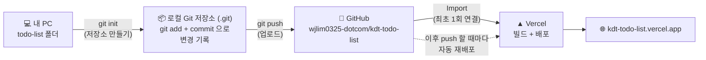
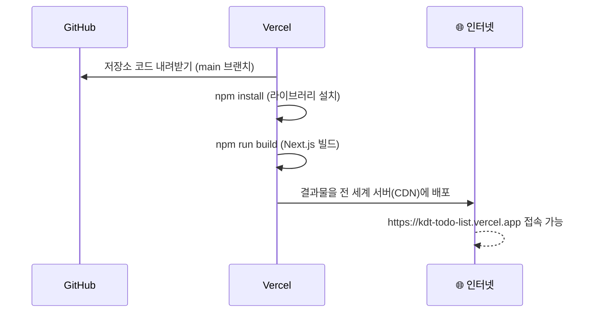

# Git 생성부터 Vercel 배포까지 — 단계별 가이드

> Git, GitHub, Vercel 을 처음 써보는 팀원을 위한 안내서입니다.
> 이 프로젝트(`kdt-todo-list`)를 실제로 올리고 배포한 과정을 그대로 따라 적었습니다.
> 화면 메뉴 이름은 **VS Code 영어 버전** 기준이며, 터미널 명령어도 함께 적었습니다. 둘 중 편한 방법 하나만 따라 하면 됩니다.

**목차**
- [0. 전체 흐름 한눈에 보기](#0-전체-흐름-한눈에-보기)
- [1. 준비물 설치](#1-준비물-설치)
- [2. Git 사용자 정보 설정 (PC 당 1회)](#2-git-사용자-정보-설정-pc-당-1회)
- [3. 로컬 Git 저장소 만들기](#3-로컬-git-저장소-만들기)
- [4. 올리면 안 되는 파일 확인 (.gitignore)](#4-올리면-안-되는-파일-확인-gitignore)
- [5. 첫 커밋 하기](#5-첫-커밋-하기)
- [6. GitHub 에 저장소 만들기](#6-github-에-저장소-만들기)
- [7. 로컬 ↔ GitHub 연결하고 올리기 (push)](#7-로컬--github-연결하고-올리기-push)
- [8. Vercel 로 배포하기](#8-vercel-로-배포하기)
- [9. 배포 후 확인](#9-배포-후-확인)
- [10. 이후 수정 사항 반영하기](#10-이후-수정-사항-반영하기)
- [11. 문제 해결 (실제로 겪은 것 포함)](#11-문제-해결-실제로-겪은-것-포함)
- [부록. 용어 정리 / 명령어 요약](#부록-용어-정리--명령어-요약)

---

## 0. 전체 흐름 한눈에 보기



| 단계 | 어디서 | 한 번만? |
|---|---|---|
| 준비물 설치, Git 사용자 설정 | 내 PC | ✅ PC 당 1회 |
| 로컬 저장소 만들기, GitHub 저장소 만들기, 연결 | 내 PC + GitHub 웹 | ✅ 프로젝트 당 1회 |
| Vercel 연결 | Vercel 웹 | ✅ 프로젝트 당 1회 |
| **커밋 → push** | 내 PC | 🔁 수정할 때마다 (배포는 자동) |

---

## 1. 준비물 설치

| 준비물 | 용도 | 설치 확인 명령 | 설치 주소 |
|---|---|---|---|
| **Node.js** (18.18 이상, LTS 권장) | 프로젝트 실행·빌드 | `node -v` | https://nodejs.org |
| **Git** | 변경 기록, 업로드 | `git --version` | https://git-scm.com/download/win |
| **VS Code** | 코드 편집, Git 화면 조작 | — | https://code.visualstudio.com |
| **GitHub 계정** | 코드 저장소 | — | https://github.com/signup |
| **Vercel 계정** | 배포 (GitHub 계정으로 가입) | — | https://vercel.com/signup |

**설치 확인 방법**
1. VS Code 에서 터미널을 엽니다: 메뉴 **Terminal → New Terminal** (단축키 `` Ctrl+` ``)
2. 아래 명령을 하나씩 입력합니다. 버전 번호가 나오면 설치된 것입니다.
   ```bash
   node -v      # 예: v22.17.0
   npm -v       # 예: 10.9.2
   git --version  # 예: git version 2.47.0.windows.1
   ```

> ⚠️ Windows PowerShell 에서 `npm` 을 실행했는데 **"이 시스템에서 스크립트를 실행할 수 없으므로…"** 오류가 나면 → [11-1](#11-1-npm-실행-시-스크립트를-실행할-수-없으므로-오류) 참고

> 💡 Git 설치 중 나오는 선택지는 모두 기본값으로 두고 Next 를 눌러도 됩니다. 설치 후 **VS Code 를 완전히 껐다 켜야** 터미널에서 `git` 이 인식됩니다.

---

## 2. Git 사용자 정보 설정 (PC 당 1회)

커밋할 때 "누가 했는지"가 기록됩니다. **GitHub 계정과 같은 이메일**을 쓰면 GitHub 에서 내 프로필과 연결되어 보입니다.

```bash
git config --global user.name "wjlim"
git config --global user.email "GitHub에 등록한 이메일"
```

확인:
```bash
git config user.name
git config user.email
```

> 💡 GitHub 에 이메일을 공개하고 싶지 않다면, GitHub → **Settings → Emails** 에 표시되는 `숫자+아이디@users.noreply.github.com` 주소를 대신 사용할 수 있습니다.

---

## 3. 로컬 Git 저장소 만들기

"이 폴더의 변경을 Git 으로 기록하겠다"고 선언하는 단계입니다. 실행하면 폴더 안에 숨김 폴더 **`.git`** 이 생기고, 여기에 모든 기록이 저장됩니다.

### 이 프로젝트의 경우 — 이미 되어 있음
이 프로젝트는 `npx create-next-app` 으로 만들었는데, 이 도구가 **자동으로 `git init` 과 첫 커밋("Initial commit from Create Next App")** 까지 해 줍니다. 그래서 이 단계는 건너뛰었습니다.

확인 방법:
```bash
cd C:\project\todo-list
git status
```
- `On branch master` / `On branch main` 같은 문구가 나오면 → 이미 저장소입니다. **4단계로**.
- `fatal: not a git repository` 가 나오면 → 아래 방법으로 만드세요.

### 저장소가 없을 때 만드는 방법

**방법 A — VS Code 화면**
1. **File → Open Folder…** 로 프로젝트 폴더(`C:\project\todo-list`)를 엽니다.
   > ⚠️ 상위 폴더(`C:\project`)가 아니라 **`package.json` 이 들어 있는 폴더**를 열어야 합니다.
2. 왼쪽 세로 막대의 **Source Control** 아이콘(가지 모양, `Ctrl+Shift+G`)을 누릅니다.
3. **Initialize Repository** 버튼을 누릅니다.

**방법 B — 터미널**
```bash
cd C:\project\todo-list
git init
```

### 브랜치 이름을 `main` 으로 맞추기
GitHub 의 기본 브랜치 이름은 `main` 입니다. 예전 방식으로 `master` 가 만들어졌다면 바꿔 둡니다.

- **VS Code**: `Ctrl+Shift+P` → `Git: Rename Branch...` 입력 → `main` → Enter
- **터미널**:
  ```bash
  git branch -M main
  ```

> 💡 VS Code 왼쪽 아래 상태 표시줄에 현재 브랜치 이름이 보입니다.

---

## 4. 올리면 안 되는 파일 확인 (.gitignore)

`.gitignore` 파일에 적힌 파일·폴더는 Git 이 **무시**합니다(기록·업로드 안 함). 공개 저장소에 올리기 전에 반드시 확인하세요.

이 프로젝트의 [.gitignore](../.gitignore) 주요 내용:

| 항목 | 무시하는 이유 |
|---|---|
| `/node_modules` | 라이브러리 설치 폴더. 수백 MB 이고 `npm install` 로 언제든 다시 만들 수 있음 |
| `/.next/` | 빌드 결과물. Vercel 이 직접 다시 빌드함 |
| `.env*` | **비밀 값(API 키 등)** 이 들어가는 환경 변수 파일 |
| `!.env.example` | 예외: 변수 **이름만** 적은 예시 파일은 올림 (`!` = 무시하지 않음) |

확인 방법: VS Code **Source Control** 의 **Changes** 목록에 `node_modules`, `.next`, `.env.local` 이 **보이지 않으면** 정상입니다.

> ⚠️ 비밀번호·토큰·API 키를 코드나 커밋에 넣지 마세요. 한 번 GitHub 에 올라가면 지워도 기록(history)에 남습니다. 실수로 올렸다면 **그 키를 즉시 폐기**하고 새로 발급받는 것이 가장 안전합니다.

---

## 5. 첫 커밋 하기

**커밋(commit)** = 지금 파일 상태를 "저장 지점"으로 기록하는 것. 게임의 세이브 포인트와 비슷합니다.
커밋은 2단계입니다: **스테이징**(이번에 기록할 파일 고르기) → **커밋**(메시지와 함께 기록)

### 방법 A — VS Code 화면
1. **Source Control** (`Ctrl+Shift+G`) 을 엽니다.
2. **Changes** 목록에 바뀐 파일들이 보입니다.
   - `U` (Untracked) = 새 파일, `M` (Modified) = 수정됨, `D` (Deleted) = 삭제됨
3. **Changes** 글자 오른쪽에 마우스를 올리면 나오는 **`+` (Stage All Changes)** 를 누릅니다.
   → 파일들이 **Staged Changes** 로 이동합니다.
4. 위쪽 **Message** 입력칸에 커밋 메시지를 씁니다.
   ```
   feat: Todo List 구현 (목록/상세, 반응형, 이미지 업로드, 코드 가이드)
   ```
5. **✓ Commit** 버튼을 누릅니다.

> 💡 스테이징 없이 Commit 을 누르면 "There are no staged changes. Would you like to stage all your changes and commit them directly?" 라고 묻습니다. **Yes** 를 누르면 전체 스테이징 + 커밋이 한 번에 됩니다.

### 방법 B — 터미널
```bash
git add .                      # 모든 변경 사항 스테이징 ('.' = 현재 폴더 전체)
git commit -m "feat: Todo List 구현 (목록/상세, 반응형, 이미지 업로드, 코드 가이드)"
```

### 확인
```bash
git log --oneline
```
```
c406689 feat: Todo List 구현 (목록/상세, 반응형, 이미지 업로드, 코드 가이드)
5e85702 Initial commit from Create Next App
```

### 커밋 메시지 작성 팁
앞에 종류를 붙이면 기록을 보기 쉽습니다.

| 접두어 | 의미 | 예 |
|---|---|---|
| `feat:` | 새 기능 | `feat: 할 일 삭제 기능` |
| `fix:` | 버그 수정 | `fix: 빈 이름으로 수정되는 문제` |
| `style:` | 화면 스타일 | `style: 모바일 버튼 크기 조정` |
| `docs:` | 문서 | `docs: 배포 링크 추가` |
| `refactor:` | 동작 변화 없는 코드 정리 | `refactor: API 함수 분리` |

---

## 6. GitHub 에 저장소 만들기

1. https://github.com 에 로그인합니다.
2. 오른쪽 위 **`+`** → **New repository** 를 누릅니다. (또는 https://github.com/new 로 바로 이동)
3. 아래처럼 입력합니다.

   | 항목 | 입력값 | 설명 |
   |---|---|---|
   | Owner | `wjlim0325-dotcom` | 내 계정 |
   | Repository name | `kdt-todo-list` | 저장소 이름 (주소에 쓰임) |
   | Description | (선택) 할 일 목록 관리 To Do 서비스 | |
   | 공개 범위 | **Public** | 과제 제출 조건: public |
   | Add a README file | **체크 해제** ❌ | |
   | Add .gitignore | **None** ❌ | |
   | Choose a license | **None** ❌ | |

   > ⚠️ **README / .gitignore / license 를 추가하지 마세요.** 내 PC 에 이미 같은 파일이 있어서, GitHub 쪽에도 파일이 생기면 첫 push 가 거절됩니다. (→ [11-4](#11-4-push-시-rejected--fetch-first-오류))

4. **Create repository** 를 누릅니다.
5. 생성된 페이지에 표시되는 주소를 복사해 둡니다.
   ```
   https://github.com/wjlim0325-dotcom/kdt-todo-list.git
   ```

---

## 7. 로컬 ↔ GitHub 연결하고 올리기 (push)

**원격(remote)** = 내 PC 저장소와 연결된 인터넷 상의 저장소(GitHub). 보통 이름을 **`origin`** 으로 짓습니다.
**push** = 내 PC 의 커밋을 원격으로 업로드.

### 방법 A — VS Code 화면
1. **Source Control** 패널 위쪽의 **`...` (Views and More Actions)** 를 누릅니다.
2. **Remote → Add Remote...** 를 누릅니다.
3. 위쪽 입력창("Provide repository URL or pick a repository source")에 주소를 붙여넣고 Enter.
   ```
   https://github.com/wjlim0325-dotcom/kdt-todo-list.git
   ```
4. "Provide a remote name" 이 나오면 **`origin`** 입력 후 Enter.
   > ⚠️ 철자 주의! 실제로 `orgin` 으로 오타를 낸 적이 있습니다. (→ [11-5](#11-5-원격-이름-오타-orgin))
5. 패널에 나타나는 **Publish Branch** 버튼을 누릅니다. (안 보이면 `...` → **Push**)
6. 처음이라면 로그인 창이 뜹니다.
   - "The extension 'GitHub' wants to sign in using GitHub." → **Allow**
   - 브라우저가 열리면 GitHub 로그인 → **Authorize Visual-Studio-Code** (또는 **Authorize Git Credential Manager**)
   - 다시 VS Code 로 돌아오면 업로드가 진행됩니다.

### 방법 B — 터미널
```bash
git remote add origin https://github.com/wjlim0325-dotcom/kdt-todo-list.git
git push -u origin main
```
- `-u` 는 "앞으로 이 브랜치의 기본 업로드 대상은 origin/main" 으로 기억시키는 옵션입니다. 처음 한 번만 붙이면 이후에는 `git push` 만 입력하면 됩니다.
- 로그인 창(Git Credential Manager)이 브라우저로 뜨면 위 6번과 같이 로그인합니다.

### 확인
1. 브라우저에서 https://github.com/wjlim0325-dotcom/kdt-todo-list 를 새로고침 → 파일 목록이 보이면 성공.
2. 터미널에서:
   ```bash
   git remote -v
   ```
   ```
   origin  https://github.com/wjlim0325-dotcom/kdt-todo-list.git (fetch)
   origin  https://github.com/wjlim0325-dotcom/kdt-todo-list.git (push)
   ```
   ```bash
   git status -sb
   ```
   ```
   ## main...origin/main      ← 로컬 main 이 origin/main 과 연결됨 (뒤에 [ahead 1] 같은 표시가 없으면 업로드 완료)
   ```

---

## 8. Vercel 로 배포하기

**Vercel** = Next.js 를 만든 회사의 배포 서비스. GitHub 저장소를 연결하면 **빌드(`npm run build`) → 인터넷 주소 발급**까지 자동으로 해 줍니다. 개인 용도(Hobby)는 무료입니다.

### 8-1. 가입 / 로그인
1. https://vercel.com 접속 → **Sign Up** (계정이 있으면 **Log In**)
2. **Continue with GitHub** 선택 → GitHub 로그인 → **Authorize Vercel**
3. 플랜을 물으면 **Hobby** (무료, 개인 프로젝트용) 선택 → 이름 입력 → **Continue**

### 8-2. 프로젝트 가져오기 (Import)
1. **https://vercel.com/new** 로 이동합니다.
   > 💡 대시보드의 **Add New… → Project** 버튼과 같은 화면입니다. 화면 구성이 바뀌어 버튼이 안 보일 때는 이 주소로 바로 들어가세요.
2. **Import Git Repository** 목록에서 `kdt-todo-list` 옆 **Import** 를 누릅니다.
   - 목록에 없으면 → [11-6](#11-6-vercel-목록에-저장소가-안-보임)
3. **Configure Project** 화면이 나옵니다. 이 프로젝트는 **아무것도 바꾸지 않아도 됩니다.**

   | 항목 | 값 | 설명 |
   |---|---|---|
   | Project Name | `kdt-todo-list` | 배포 주소 `https://kdt-todo-list.vercel.app` 에 쓰임 |
   | Framework Preset | **Next.js** (자동 인식) | |
   | Root Directory | `./` | `package.json` 이 저장소 맨 위에 있으므로 그대로 |
   | Build Command | `npm run build` (기본값) | |
   | Output Directory | 기본값 | |
   | Install Command | `npm install` (기본값) | |

4. **Environment Variables** (선택)
   - 이 프로젝트는 API 요청에 쓰는 사용자 구분값 `NEXT_PUBLIC_TENANT_ID` 를 환경 변수로 바꿀 수 있습니다.
   - **비워두면 코드의 기본값(`doit-todo-a7k3`)** 을 사용합니다. 실제 배포도 비워둔 상태로 했습니다.
   - 바꾸고 싶다면: Key = `NEXT_PUBLIC_TENANT_ID`, Value = `원하는-고유값` 입력 → **Add**
   > ⚠️ `NEXT_PUBLIC_` 으로 시작하는 값은 **빌드할 때 코드에 박혀** 브라우저에서 누구나 볼 수 있습니다. 비밀 값은 넣지 마세요. 그리고 값을 바꾼 뒤에는 **재배포해야** 적용됩니다. (→ [11-8](#11-8-환경-변수를-바꿨는데-반영이-안-됨))

5. **Deploy** 를 누릅니다.
6. 빌드 로그가 흘러가고 1~2분 뒤 **🎉 Congratulations!** 화면과 미리보기가 나오면 성공입니다.
7. **Continue to Dashboard** → **Domains** 항목에 표시된 주소가 배포 주소입니다.
   ```
   https://kdt-todo-list.vercel.app
   ```

### 8-3. Vercel 이 한 일


---

## 9. 배포 후 확인

배포 주소에서 과제 체크리스트를 직접 눌러 확인합니다.

- [ ] 로고 클릭 시 `/` 로 새로고침 이동
- [ ] 할 일 입력 → `추가하기` 클릭 / Enter 로 추가
- [ ] 체크 버튼으로 TO DO ↔ DONE 이동
- [ ] 항목 클릭 → 상세 페이지 이동
- [ ] 이름 / 상태 / 메모 수정, 이미지 첨부 (한글 파일명·5MB 초과는 거절되는지)
- [ ] `수정 완료` → 목록으로 이동, 다시 들어가면 메모·이미지 유지
- [ ] `삭제하기` → 삭제 후 목록으로 이동
- [ ] 휴대폰 / 브라우저 창 크기를 줄여 모바일·태블릿 레이아웃 확인 (PC 에서는 `F12` → 왼쪽 위 📱 아이콘으로 기기 크기 변경 가능)

### README 에 배포 링크 넣기
[README.md](../README.md) 의 배포 링크 줄을 실제 주소로 바꾸고 커밋·push 합니다.
```markdown
- 배포 링크: https://kdt-todo-list.vercel.app
```

### 과제 제출 (나인하이어)
| 제출 항목 | 값 |
|---|---|
| GitHub 저장소 링크 | https://github.com/wjlim0325-dotcom/kdt-todo-list |
| 배포 링크 | https://kdt-todo-list.vercel.app |

---

## 10. 이후 수정 사항 반영하기

연결이 끝난 뒤에는 **커밋 → push 만 하면 Vercel 이 자동으로 다시 배포**합니다.


### VS Code 화면
1. 파일 수정 후 저장 (`Ctrl+S`)
2. **Source Control** → **`+`** (Stage All Changes)
3. 메시지 입력 (예: `docs: 배포 링크 추가`) → **✓ Commit**
4. **Sync Changes** (또는 `...` → **Push**)

### 터미널
```bash
git add .
git commit -m "docs: 배포 링크 추가"
git push
```

### 배포 상태 확인
- Vercel 대시보드 → 프로젝트 → **Deployments** 탭: 각 push 마다 배포 기록이 생깁니다.
  - 🟢 **Ready** = 배포 완료 / 🟡 **Building** = 진행 중 / 🔴 **Error** = 실패 (클릭하면 빌드 로그 확인)
- GitHub 저장소의 커밋 옆에도 ✅(성공) / ❌(실패) 표시가 붙습니다.

> 💡 **push 전에 내 PC 에서 `npm run build` 를 한 번 실행**해 보세요. 여기서 에러가 나면 Vercel 에서도 똑같이 실패합니다.

---

## 11. 문제 해결 (실제로 겪은 것 포함)

### 11-1. `npm` 실행 시 "스크립트를 실행할 수 없으므로" 오류
```
npm : 이 시스템에서 스크립트를 실행할 수 없으므로 C:\Program Files\nodejs\npm.ps1 파일을 로드할 수 없습니다.
```
**원인**: Windows PowerShell 의 기본 보안 설정(실행 정책)이 `.ps1` 스크립트 실행을 막음. 코드 문제 아님.
**해결** (둘 중 하나):
- 바로 실행: `npm` 대신 **`npm.cmd`** 입력 → `npm.cmd run dev`
- 영구 해결 (1회, 관리자 권한 불필요):
  ```powershell
  Set-ExecutionPolicy -Scope CurrentUser RemoteSigned
  ```
  `Y` 입력. 이후 `npm` 정상 동작.

### 11-2. 편집한 내용이 커밋에 안 들어감
**원인**: 파일을 **저장하지 않음**. VS Code 탭 이름 옆에 **●** 가 있으면 저장 안 된 상태입니다.
**해결**: `Ctrl+S` 로 저장 후 다시 스테이징. (자동 저장: **File → Auto Save** 체크)

### 11-3. Source Control 에 "Initialize Repository" 만 보이거나 변경 사항이 안 보임
**원인**: VS Code 로 연 폴더가 Git 저장소 폴더가 아님 (예: `C:\project` 를 열었는데 저장소는 `C:\project\todo-list`).
**해결**: **File → Open Folder…** 로 `package.json` 이 있는 폴더(`todo-list`)를 다시 엽니다.

### 11-4. push 시 `rejected` / `fetch first` 오류
```
! [rejected]        main -> main (fetch first)
error: failed to push some refs to 'https://github.com/...'
```
**원인**: GitHub 저장소를 만들 때 README 등을 추가해서, GitHub 에 내 PC 에 없는 커밋이 있음.
**해결**: GitHub 쪽 기록을 먼저 합친 뒤 다시 push.
```bash
git pull origin main --allow-unrelated-histories
# 충돌(conflict)이 나면 VS Code 에서 파일을 열어 남길 내용을 고른 뒤 저장 → 커밋
git push -u origin main
```
> ⚠️ 인터넷 검색으로 나오는 `git push --force` 는 GitHub 쪽 기록을 **지워 버리므로** 팀 작업에서는 쓰지 마세요.

### 11-5. 원격 이름 오타 (`orgin`)
```
fatal: 'origin' does not appear to be a git repository
```
**원인**: 원격을 추가할 때 이름을 `orgin` 처럼 잘못 입력. (VS Code 버튼으로 push 하면 동작하지만, `git push origin ...` 명령은 실패)
**확인**: `git remote -v`
**해결**:
```bash
git remote rename orgin origin
```

### 11-6. Vercel 목록에 저장소가 안 보임
**원인**: Vercel 이 GitHub 의 해당 저장소에 접근할 권한이 없음.
**해결**:
1. Import 목록 아래 **Adjust GitHub App Permissions →** 클릭
2. GitHub 화면의 **Repository access** 에서 `All repositories` 선택 또는 **Only select repositories** → `kdt-todo-list` 추가
3. **Save** → Vercel 화면으로 돌아와 새로고침

### 11-7. Vercel 빌드 실패 (🔴 Error)
1. Deployments → 실패한 배포 클릭 → **Building** 로그에서 빨간 `Error` 줄을 찾습니다.
2. 내 PC 에서 `npm run build` 를 실행해 같은 에러가 나는지 확인하고 고칩니다.
3. 자주 있는 원인

   | 로그 내용 | 원인 / 해결 |
   |---|---|
   | `Type error: ...` | TypeScript 타입 오류. 해당 파일·줄 수정 |
   | `Module not found: Can't resolve '...'` | import 경로 오타, 또는 **파일 이름 대소문자** 불일치 (Windows 는 구분 안 하지만 Vercel(Linux)은 구분함) |
   | `npm ERR!` (install 단계) | `package-lock.json` 이 커밋되지 않았거나 깨짐 → 로컬에서 `npm install` 후 lock 파일 커밋 |

### 11-8. 환경 변수를 바꿨는데 반영이 안 됨
**원인**: `NEXT_PUBLIC_*` 값은 **빌드할 때** 코드에 들어갑니다. 값만 바꾸고 다시 빌드하지 않으면 예전 값이 그대로 쓰입니다.
**해결**: Vercel → 프로젝트 → **Deployments** → 최신 배포의 **`...` → Redeploy**

### 11-9. GitHub 로그인 창이 안 뜨거나 인증 실패
- VS Code 왼쪽 아래 **Accounts**(사람 아이콘) → GitHub 로그인 상태 확인 후 다시 로그인
- 터미널에서 push 할 때 비밀번호를 물으면: GitHub 는 **계정 비밀번호로 push 할 수 없습니다.** Git 을 최신 버전으로 재설치하면 포함된 **Git Credential Manager** 가 브라우저 로그인 창을 띄워 줍니다.
- Windows **자격 증명 관리자 → Windows 자격 증명** 에서 `git:https://github.com` 항목을 삭제하면 저장된 로그인 정보가 초기화되어 다시 로그인할 수 있습니다.

---

## 부록. 용어 정리 / 명령어 요약

### 용어
| 용어 | 뜻 |
|---|---|
| **저장소 (repository, repo)** | 프로젝트 파일 + 변경 기록 전체. 로컬(내 PC)과 원격(GitHub) 두 곳에 있음 |
| **커밋 (commit)** | 특정 시점의 파일 상태를 메시지와 함께 저장한 기록 |
| **스테이징 (stage)** | 이번 커밋에 포함할 변경을 고르는 것 |
| **브랜치 (branch)** | 독립된 작업 줄기. 기본은 `main` |
| **원격 (remote)** | 연결된 인터넷 저장소. 보통 이름은 `origin` |
| **push / pull** | 내 PC → GitHub 업로드 / GitHub → 내 PC 다운로드 |
| **빌드 (build)** | 개발용 코드를 실제 서비스용 파일로 변환 (`npm run build`) |
| **배포 (deploy)** | 빌드 결과를 인터넷에서 접속 가능하게 올리는 것 |
| **환경 변수** | 코드 밖에서 주입하는 설정값 (`.env.local`, Vercel Environment Variables) |

### 명령어 요약
```bash
# ── 최초 1회 ──────────────────────────────────────────
git config --global user.name "이름"
git config --global user.email "이메일"
git init                                   # 저장소 만들기 (create-next-app 은 자동)
git branch -M main                         # 브랜치 이름 main 으로
git remote add origin https://github.com/wjlim0325-dotcom/kdt-todo-list.git
git push -u origin main                    # 첫 업로드

# ── 수정할 때마다 ─────────────────────────────────────
npm run build                              # (권장) 빌드 되는지 먼저 확인
git status                                 # 바뀐 파일 확인
git add .                                  # 전체 스테이징
git commit -m "feat: 무엇을 했는지"         # 커밋
git push                                   # 업로드 → Vercel 자동 재배포

# ── 확인용 ───────────────────────────────────────────
git log --oneline                          # 커밋 기록
git remote -v                              # 원격 주소
git status -sb                             # 현재 브랜치와 업로드 상태
```
