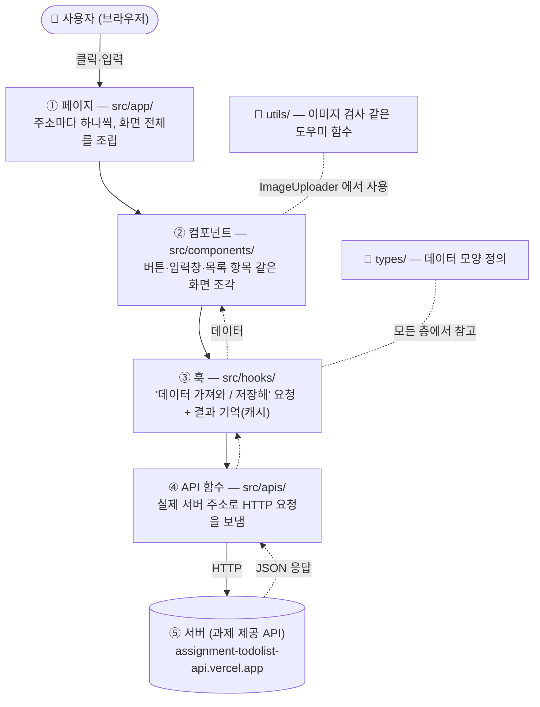
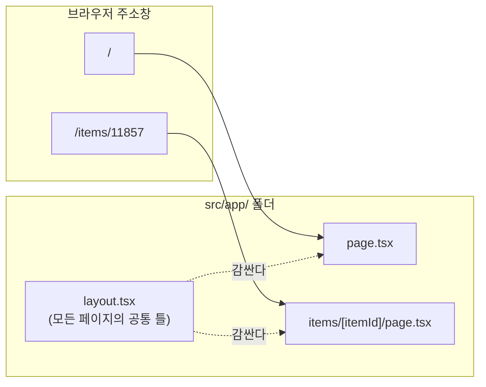
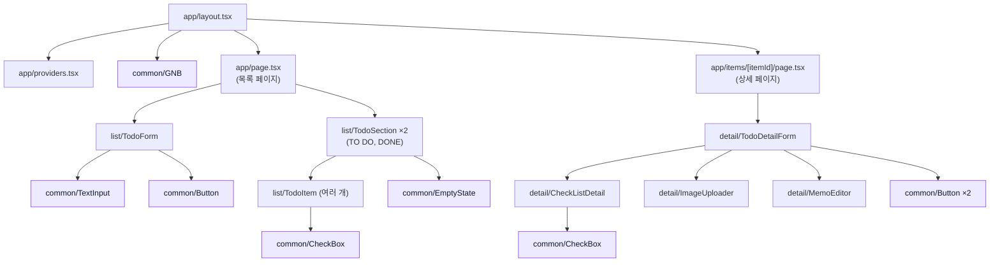
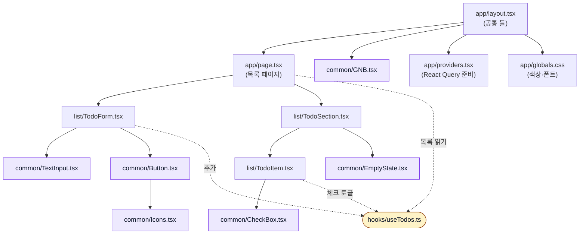
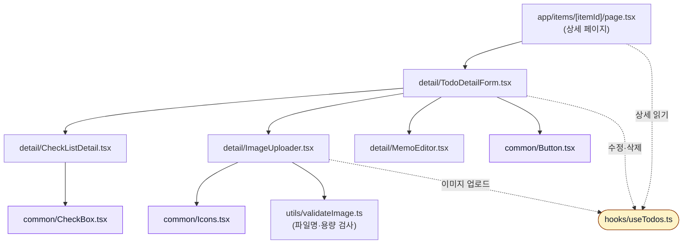
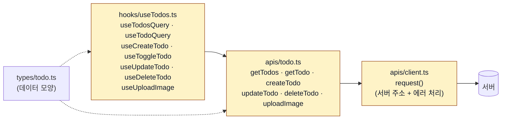
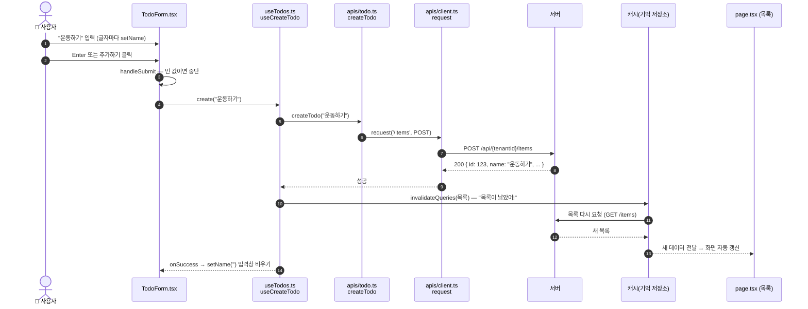
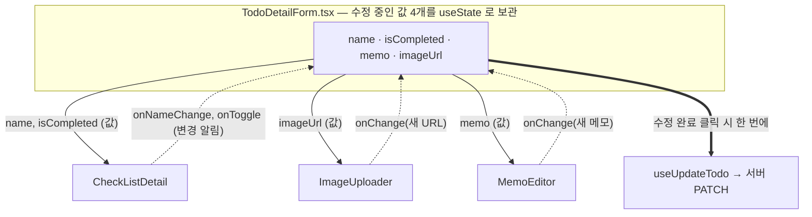
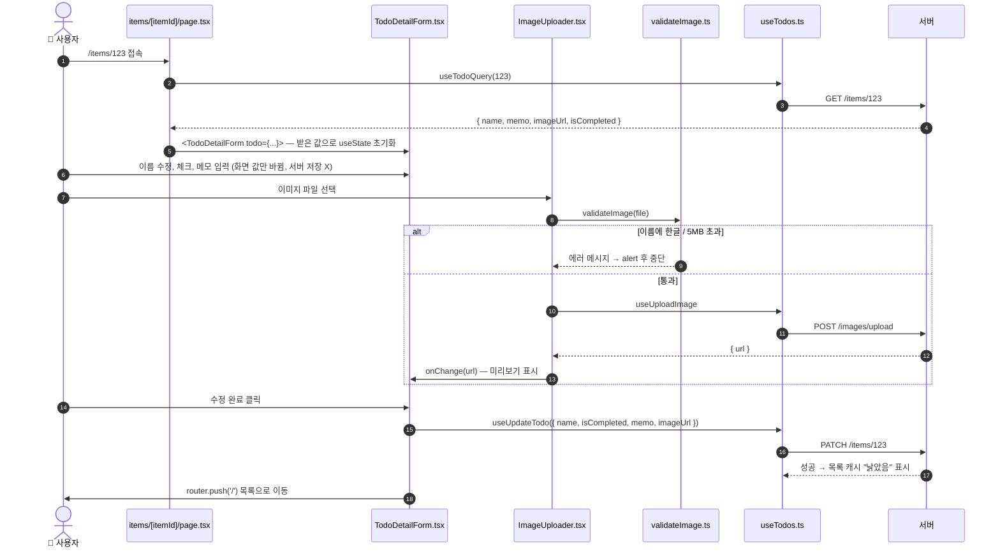
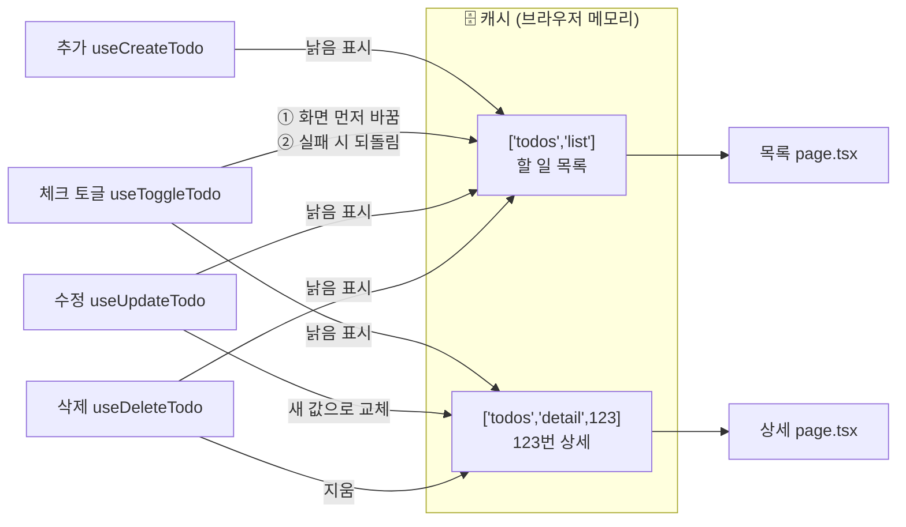

# 코드 읽기 가이드

> Next.js, TypeScript, React 를 처음 접하는 팀원을 위한 안내서입니다.
> 이 문서의 순서대로 읽으면 "어떤 파일이 무슨 일을 하고, 서로 어떻게 연결되는지"를 이해할 수 있습니다.

**목차**
1. [큰 그림: 5개의 층](#1-큰-그림-5개의-층)
2. [주소(URL) → 파일](#2-주소url--파일)
3. [화면 → 컴포넌트 파일](#3-화면--컴포넌트-파일)
4. [파일 연결 지도 (전체)](#4-파일-연결-지도-전체)
5. [이것만 알면 코드가 읽힌다 (개념 10개)](#5-이것만-알면-코드가-읽힌다-개념-10개)
6. [따라 읽기 ①: 할 일 추가](#6-따라-읽기--할-일-추가)
7. [따라 읽기 ②: 상세 페이지 수정 완료](#7-따라-읽기--상세-페이지-수정-완료)
8. [데이터 저장소(캐시)는 어떻게 최신 상태를 유지하나](#8-데이터-저장소캐시는-어떻게-최신-상태를-유지하나)
9. [처음 보면 의아한 코드들 (왜 이렇게 했나)](#9-처음-보면-의아한-코드들-왜-이렇게-했나)
10. [자주 하는 작업 레시피](#10-자주-하는-작업-레시피)

> 💡 아래 다이어그램은 GitHub 에서 그림으로 보입니다. VS Code 에서 보려면 확장 프로그램 "Markdown Preview Mermaid Support" 를 설치한 뒤 미리보기(`Ctrl+Shift+V`)를 여세요.

---

## 1. 큰 그림: 5개의 층

이 프로젝트의 코드는 **위에서 아래로만 호출하는 5개의 층**으로 나뉩니다.
위층은 아래층을 쓰지만, 아래층은 위층을 모릅니다. 그래서 어떤 파일을 고칠 때 "위쪽만 영향을 받는다"고 생각하면 됩니다.



| 층 | 폴더 | 한 줄 설명 | 비유 |
|---|---|---|---|
| ① 페이지 | [src/app/](../src/app/) | 주소(URL) 하나 = 파일 하나. 화면 전체를 조립 | 건물의 각 층 |
| ② 컴포넌트 | [src/components/](../src/components/) | 화면을 이루는 재사용 가능한 조각 | 레고 블록 |
| ③ 훅 | [src/hooks/](../src/hooks/) | 서버 데이터를 가져오고 저장하는 로직 + 결과를 기억 | 비서 |
| ④ API 함수 | [src/apis/](../src/apis/) | 서버에 실제로 요청을 보내는 함수 | 우체부 |
| 보조 | [src/types/](../src/types/), [src/utils/](../src/utils/) | 데이터 모양 정의, 도우미 함수 | 설계도, 공구함 |

---

## 2. 주소(URL) → 파일

Next.js 는 **`src/app/` 폴더 구조가 곧 웹사이트 주소**가 됩니다. 라우터 설정 파일이 따로 없습니다.



| 주소 | 파일 | 화면 |
|---|---|---|
| `/` | [src/app/page.tsx](../src/app/page.tsx) | 할 일 목록 |
| `/items/123` | [src/app/items/[itemId]/page.tsx](../src/app/items/[itemId]/page.tsx) | 할 일 상세 (123번) |
| (모든 주소) | [src/app/layout.tsx](../src/app/layout.tsx) | 상단 로고 바(GNB) + 공통 설정. 모든 페이지를 감쌈 |

- 폴더 이름의 **대괄호 `[itemId]`** 는 "이 자리에 아무 값이나 올 수 있다"는 뜻입니다. `/items/5`, `/items/999` 모두 같은 파일이 처리하고, 코드에서 `useParams()` 로 `itemId` 값("5", "999")을 꺼내 씁니다.
- 파일 이름 `page.tsx`, `layout.tsx` 는 Next.js 가 정해 둔 **약속된 이름**입니다. 이름을 바꾸면 동작하지 않습니다.

---

## 3. 화면 → 컴포넌트 파일

화면의 각 부분이 어떤 파일인지 보여줍니다. 수정하고 싶은 부분을 화면에서 찾고 → 파일을 열면 됩니다.

### 할 일 목록 페이지 (`/`)

```
┌──────────────────────────────────────────────────────────────┐
│ 🟣 do it;                                         ← GNB.tsx  │
├──────────────────────────────────────────────────────────────┤
│ ┌──────────────────────────────────┐ ┌────────────┐          │
│ │ 할 일을 입력해주세요  ← TextInput │ │ + 추가하기 │← Button  │
│ └──────────────────────────────────┘ └────────────┘          │
│ └─────────────────── TodoForm.tsx ──────────────────┘        │
│                                                              │
│ [TO DO]  ← TodoSection.tsx      [DONE]  ← TodoSection.tsx    │
│ ┌─────────────────────────┐     ┌─────────────────────────┐  │
│ │ ○ 운동하기   ← TodoItem │     │ ● ~~은행 다녀오기~~     │  │
│ └─────────────────────────┘     └─────────────────────────┘  │
│   ↑ CheckBox.tsx                  (비어 있으면 EmptyState)   │
└──────────────────────────────────────────────────────────────┘
```

### 할 일 상세 페이지 (`/items/{itemId}`)

```
┌──────────────────────────────────────────────────────────────┐
│ 🟣 do it;                                         ← GNB.tsx  │
├──────────────────────────────────────────────────────────────┤
│ ┌──────────────────────────────────────────────────────────┐ │
│ │            ○ 비타민 챙겨 먹기     ← CheckListDetail.tsx  │ │
│ └──────────────────────────────────────────────────────────┘ │
│ ┌──────────────────┐ ┌─────────────────────────────────────┐ │
│ │   🖼️             │ │              Memo                   │ │
│ │       (+)        │ │   오메가 3 챙겨먹기                 │ │
│ │ ImageUploader    │ │              ← MemoEditor.tsx       │ │
│ └──────────────────┘ └─────────────────────────────────────┘ │
│                          [✓ 수정 완료] [✕ 삭제하기] ← Button │
│ └──────────────────── TodoDetailForm.tsx ──────────────────┘ │
└──────────────────────────────────────────────────────────────┘
```

### 컴포넌트 포함 관계 (누가 누구를 안에 넣나)



보라색 상자는 **공용 컴포넌트**([src/components/common/](../src/components/common/))입니다. 여러 화면에서 같은 부품을 재사용합니다.
예를 들어 `CheckBox` 는 목록의 항목과 상세 페이지 상단에서 똑같이 쓰입니다.

---

## 4. 파일 연결 지도 (전체)

모든 `.ts` / `.tsx` 파일이 서로 어떤 파일을 `import`(가져다 씀) 하는지 나타낸 지도입니다.
**화살표 A → B 는 "A 가 B 를 가져다 쓴다"** 는 뜻입니다.

한 장에 모든 선을 그리면 복잡해지므로 **목록 쪽 / 상세 쪽 / 서버 통신** 세 장으로 나눴습니다.
**화살표 A → B 는 "A 가 B 를 가져다 쓴다"** 는 뜻이고, 보라색은 공용 컴포넌트, 주황색은 서버와 통신하는 파일입니다.

#### ⓐ 목록 페이지 쪽



#### ⓑ 상세 페이지 쪽



#### ⓒ 서버 통신 (위 두 그림의 점선이 모이는 곳)



**읽는 팁**
- 서버와 통신하는 길은 **반드시 `hooks/useTodos.ts` → `apis/todo.ts` → `apis/client.ts`** 한 줄뿐입니다. 컴포넌트가 서버 주소를 직접 부르는 곳은 없습니다.
- 그래서 "서버 주소가 바뀌었다" → `client.ts` 한 곳, "새 API 추가" → `todo.ts` + `useTodos.ts` 두 곳만 고치면 됩니다.

---

## 5. 이것만 알면 코드가 읽힌다 (개념 10개)

이 프로젝트에 **실제로 나오는 것만** 골랐습니다. 각 개념 옆에 "어디서 볼 수 있는지"를 적었습니다.

### 5-1. 컴포넌트 = HTML 을 돌려주는 함수
React 에서는 화면 조각을 **함수**로 만듭니다. 함수가 돌려주는 HTML 비슷한 것을 **JSX** 라고 합니다.

```tsx
// src/components/common/EmptyState.tsx (단순화)
export default function EmptyState({ type }) {
  return <p>할 일이 없어요</p>;   // ← HTML 처럼 생겼지만 JavaScript 안에 쓰는 JSX
}

// 다른 파일에서 HTML 태그처럼 사용
<EmptyState type="todo" />
```
- 파일 확장자 `.tsx` = TypeScript + JSX. JSX 가 없는 순수 로직 파일은 `.ts` 입니다.
- JSX 에서는 `class` 대신 **`className`** 을 씁니다.
- `{ }` 중괄호 안에는 JavaScript 값을 넣을 수 있습니다: `<p>{todo.name}</p>`

### 5-2. props = 컴포넌트에 넘기는 값
부모 컴포넌트가 자식에게 값을 넘길 때 HTML 속성처럼 씁니다.

```tsx
// 부모: src/components/list/TodoSection.tsx
<TodoItem todo={todo} />

// 자식: src/components/list/TodoItem.tsx
export default function TodoItem({ todo }: { todo: TodoListItem }) {
  return <span>{todo.name}</span>;
}
```
값은 **위(부모) → 아래(자식)** 로만 흐릅니다. 자식이 부모에게 알리고 싶을 때는 부모가 **함수를 props 로 넘겨주고**, 자식이 그 함수를 호출합니다 (예: `onToggle`, `onChange`). → [7장 그림](#데이터가-흐르는-방향-props-는-아래로-이벤트는-위로) 참고

### 5-3. `useState` = 화면이 기억하는 값
값이 바뀌면 **화면이 자동으로 다시 그려집니다.**

```tsx
// src/components/list/TodoForm.tsx
const [name, setName] = useState('');     // name: 현재 값, setName: 값을 바꾸는 함수
<input value={name} onChange={(e) => setName(e.target.value)} />
```
일반 변수(`let name = ''`)를 바꾸면 화면이 안 바뀝니다. 화면에 보이는 값은 꼭 `useState` 로 관리합니다.

### 5-4. 훅(Hook) = `use` 로 시작하는 특별한 함수
`useState`, `useRouter`, `useQuery` 처럼 **이름이 `use` 로 시작**하면 훅입니다.
규칙: **컴포넌트 함수의 맨 위에서만** 호출합니다 (if 문이나 반복문 안에서 호출 ❌).
우리가 직접 만든 훅은 [src/hooks/useTodos.ts](../src/hooks/useTodos.ts) 에 모여 있습니다.

### 5-5. `'use client'` = "이 파일은 브라우저에서 실행"
Next.js 는 기본적으로 컴포넌트를 **서버에서** 미리 그립니다. 하지만 클릭·입력·`useState` 같은 **상호작용**은 브라우저에서만 가능하므로, 그런 파일 맨 위에 `'use client'` 를 붙입니다.

| `'use client'` 있음 | 없음 |
|---|---|
| `page.tsx`, `TodoForm`, `TodoItem`, `TodoDetailForm`, `ImageUploader`, `useTodos.ts` … | `layout.tsx`, `Button`, `GNB`, `EmptyState` … |
| 클릭 처리, `useState`, 서버 데이터 요청을 함 | 받은 값을 그리기만 함 (단, `'use client'` 파일 안에서 쓰이면 함께 브라우저에서 실행됨) |

> 에러 메시지에 `useState only works in Client Components` 가 보이면 → 그 파일 맨 위에 `'use client'` 를 추가하세요.

### 5-6. TypeScript 의 `interface` = 데이터 모양 설계도
"이 객체에는 이런 이름의, 이런 종류의 값이 들어 있다"를 미리 적어 둡니다.

```ts
// src/types/todo.ts
export interface TodoListItem {
  id: number;           // 숫자
  name: string;         // 문자열
  isCompleted: boolean; // true / false
}
export interface TodoDetail extends TodoListItem {  // extends = 위 3개 + 아래 추가
  memo: string | null;  // 문자열 또는 null(없음)
}
```
- 덕분에 `todo.nmae` 처럼 **오타를 내면 저장 전에 VS Code 가 빨간 줄**로 알려줍니다.
- `name?: string` 의 **`?`** 는 "있어도 되고 없어도 됨"입니다 (`UpdateTodoDto` 참고).
- 함수 `(id: number) => ...` 의 `: number` 도 같은 역할입니다. **실행 결과에는 영향이 없고** 실수를 미리 잡아주는 용도입니다.

### 5-7. `import` / `export` = 파일끼리 주고받기
```ts
export default function Button() {}          // 파일의 대표 하나 → import Button from '...'
export function useTodosQuery() {}           // 이름 붙은 여러 개 → import { useTodosQuery } from '...'
import type { TodoDetail } from '@/types/todo'; // 타입만 가져올 때
```
- **`@/`** 는 `src/` 폴더를 뜻하는 줄임말입니다 ([tsconfig.json](../tsconfig.json) 에 설정). `@/hooks/useTodos` = `src/hooks/useTodos.ts`

### 5-8. TanStack Query = 서버 데이터 담당 비서
서버 데이터를 가져오고, **결과를 기억(캐시)** 했다가 여러 화면에 나눠주고, 필요하면 다시 받아오는 라이브러리입니다.

| 함수 | 용도 | 이 프로젝트 예 |
|---|---|---|
| `useQuery` | **읽기** (GET). 로딩/에러/데이터 상태를 알아서 관리 | `useTodosQuery`, `useTodoQuery` |
| `useMutation` | **쓰기** (POST/PATCH/DELETE) | `useCreateTodo`, `useUpdateTodo` … |
| `invalidateQueries` | "기억한 데이터가 낡았으니 다시 받아와" | 추가·수정·삭제 성공 후 호출 |

```tsx
// src/app/page.tsx
const { data: todos = [], isLoading, isError } = useTodosQuery();
// isLoading 이면 "불러오는 중...", isError 면 에러 문구, 아니면 todos 를 그림
```

### 5-9. Next.js 내장 부품
| 이름 | 하는 일 | 사용 위치 |
|---|---|---|
| `<Link href="...">` | 페이지 이동 (새로고침 없이 빠르게) | `TodoItem` |
| `useRouter().push('/')` | 코드에서 페이지 이동 | `TodoDetailForm` (수정/삭제 후) |
| `useParams()` | 주소의 `[itemId]` 값 꺼내기 | 상세 `page.tsx` |
| `<Image>` | 이미지 표시 (크기 고정으로 화면 덜컹거림 방지) | `GNB`, `CheckBox`, `EmptyState` … |

### 5-10. Tailwind CSS = className 으로 스타일 쓰기
별도 CSS 파일 대신 **미리 정해진 클래스 이름**을 조합합니다.

```tsx
<div className="flex h-16 items-center rounded-3xl border-2 border-slate-900 bg-white px-4 md:px-6" />
```
| 클래스 | 의미 |
|---|---|
| `flex`, `items-center` | 가로 배치, 세로 가운데 정렬 |
| `h-16` / `px-4` | 높이 64px / 좌우 안쪽 여백 16px (숫자 × 4px) |
| `h-[50px]` | 대괄호 = 정해진 단위 대신 정확한 값 |
| `bg-white`, `border-slate-900` | 배경색, 테두리색 (색 이름은 [globals.css](../src/app/globals.css) 의 `@theme` 에 정의) |
| **`md:px-6`** | **화면 폭 744px 이상**(태블릿~)일 때만 적용 |
| **`lg:flex-row`** | **화면 폭 1200px 이상**(데스크탑)일 때만 적용 |

> 반응형은 전부 `md:` / `lg:` 접두사로 처리했습니다. "모바일 기본값 → 넓어지면 덮어쓰기" 순서로 읽으면 됩니다.
> VS Code 확장 "Tailwind CSS IntelliSense" 를 설치하면 클래스에 마우스를 올렸을 때 실제 CSS 를 보여줍니다.

---

## 6. 따라 읽기 ①: 할 일 추가

"입력창에 `운동하기` 를 쓰고 Enter" 를 눌렀을 때 일어나는 일을 순서대로 따라갑니다.



| 단계 | 파일 | 볼 곳 |
|---|---|---|
| 입력값 기억 | [TodoForm.tsx](../src/components/list/TodoForm.tsx) | `useState('')`, `onChange` |
| 제출 처리 | 〃 | `handleSubmit` 함수, `<form onSubmit>` |
| 요청 + 목록 갱신 지시 | [useTodos.ts](../src/hooks/useTodos.ts) | `useCreateTodo` 의 `onSuccess` |
| 서버 주소/방식 | [apis/todo.ts](../src/apis/todo.ts) | `createTodo` |
| 실제 전송, 에러 처리 | [apis/client.ts](../src/apis/client.ts) | `request` |
| 화면 다시 그리기 | [app/page.tsx](../src/app/page.tsx) | `useTodosQuery()` → `filter` 로 TO DO / DONE 나눔 |

**핵심**: `TodoForm` 은 목록을 직접 고치지 않습니다. "목록이 낡았다"고 알리기만 하면, 목록을 쓰는 `page.tsx` 가 알아서 새 데이터로 다시 그려집니다.

---

## 7. 따라 읽기 ②: 상세 페이지 수정 완료

상세 페이지는 **"고친 내용을 화면에만 들고 있다가, 수정 완료 때 한 번에 저장"** 하는 구조입니다.

### 데이터가 흐르는 방향 (props 는 아래로, 이벤트는 위로)



자식 컴포넌트(`CheckListDetail`, `MemoEditor` 등)는 **값을 직접 바꾸지 않고** "바뀌었어요"라고 부모에게 알리기만 합니다. 실제 값은 부모(`TodoDetailForm`) 한 곳에만 있어서, 저장할 때 모아서 보내기 쉽습니다.

### 전체 순서



| 단계 | 파일 | 볼 곳 |
|---|---|---|
| 주소에서 id 꺼내기 + 데이터 요청 | [items/[itemId]/page.tsx](../src/app/items/[itemId]/page.tsx) | `useParams`, `useTodoQuery` |
| 수정 중인 값 보관, 저장/삭제 | [TodoDetailForm.tsx](../src/components/detail/TodoDetailForm.tsx) | `useState` 4개, `isDirty`, `handleUpdate`, `handleDelete` |
| 이름 + 상태 | [CheckListDetail.tsx](../src/components/detail/CheckListDetail.tsx) | `onNameChange`, `onToggle` |
| 이미지 검사 → 업로드 | [ImageUploader.tsx](../src/components/detail/ImageUploader.tsx), [validateImage.ts](../src/utils/validateImage.ts) | `handleFileChange`, 정규식 `ENGLISH_FILE_NAME` |
| 메모 | [MemoEditor.tsx](../src/components/detail/MemoEditor.tsx) | `textarea` |

---

## 8. 데이터 저장소(캐시)는 어떻게 최신 상태를 유지하나

TanStack Query 는 서버에서 받은 데이터를 **이름표(queryKey)** 를 붙여 기억합니다.



- **낡음 표시(invalidate)** 된 데이터는 그 데이터를 쓰는 화면이 있으면 자동으로 다시 받아옵니다.
- **체크 토글**은 서버 응답을 기다리면 버튼이 느리게 느껴져서, **화면을 먼저 바꾸고(낙관적 업데이트)** 서버가 실패하면 원래대로 되돌립니다 → `useToggleTodo` 의 `onMutate` / `onError`.
- 이름표는 [useTodos.ts](../src/hooks/useTodos.ts) 맨 위 `todoKeys` 에 모아 두었습니다.

---

## 9. 처음 보면 의아한 코드들 (왜 이렇게 했나)

| 코드 | 위치 | 이유 |
|---|---|---|
| 로고에 `<Link>` 대신 `<a href="/">` | [GNB.tsx](../src/components/common/GNB.tsx) | 과제 요구사항이 "로고 클릭 시 **새로고침**". `<Link>` 는 새로고침 없이 이동하므로 일부러 일반 링크 사용 |
| `pageSize = 1000` | [apis/todo.ts](../src/apis/todo.ts) | 서버 기본값이 10개라 11번째 할 일부터 안 보이는 문제 방지 |
| 입력창을 `<form onSubmit>` 으로 감쌈 | [TodoForm.tsx](../src/components/list/TodoForm.tsx) | 버튼 클릭과 Enter 를 한 함수로 처리. 한글 입력 중 Enter 가 두 번 처리되는 문제도 없음 |
| 체크 버튼을 링크 **옆**에 둠 | [TodoItem.tsx](../src/components/list/TodoItem.tsx) | 버튼을 링크 안에 넣으면 HTML 규칙 위반 + 체크할 때 상세 페이지로 넘어가 버림 |
| `<TodoDetailForm key={todo.id} …>` | [items/[itemId]/page.tsx](../src/app/items/[itemId]/page.tsx) | `key` 가 바뀌면 컴포넌트를 새로 만들어 `useState` 초기값이 다시 적용됨 |
| 숨김 `<span>` + `<input>` 겹치기 | [CheckListDetail.tsx](../src/components/detail/CheckListDetail.tsx) | 입력창 너비를 글자 길이에 맞춰 늘리기 위한 CSS 기법 (밑줄이 글자만큼만 보이도록) |
| `e.target.value = ''` | [ImageUploader.tsx](../src/components/detail/ImageUploader.tsx) | 같은 파일을 다시 선택해도 변경 이벤트가 발생하도록 |
| `NEXT_PUBLIC_TENANT_ID` | [apis/client.ts](../src/apis/client.ts) | 서버가 사용자를 구분하는 값. `NEXT_PUBLIC_` 으로 시작해야 브라우저 코드에서 읽힘. **빌드할 때 코드에 박히므로 바꾸면 다시 빌드** 필요 |

---

## 10. 자주 하는 작업 레시피

**색을 바꾸고 싶다**
→ [src/app/globals.css](../src/app/globals.css) 의 `@theme` 안 값을 수정. 그 색을 쓰는 모든 곳이 함께 바뀝니다.

**버튼 종류를 하나 추가하고 싶다**
→ [Button.tsx](../src/components/common/Button.tsx) 의 `Variant` 타입, `ICONS`, `COLORS` 세 곳에 항목 추가.

**새 API 를 붙이고 싶다**
1. [types/todo.ts](../src/types/todo.ts) — 응답 모양 `interface` 추가
2. [apis/todo.ts](../src/apis/todo.ts) — `request()` 를 호출하는 함수 추가
3. [hooks/useTodos.ts](../src/hooks/useTodos.ts) — `useQuery`(읽기) 또는 `useMutation`(쓰기) 훅 추가
4. 컴포넌트에서 훅 사용

**새 페이지를 만들고 싶다** (예: `/about`)
→ `src/app/about/page.tsx` 파일을 만들고 컴포넌트를 `export default` 하면 끝. 상단 바는 `layout.tsx` 가 자동으로 붙여 줍니다.

**화면이 이상할 때 확인 순서**
1. 브라우저 개발자 도구(`F12`) → **Console** 탭의 빨간 에러
2. **Network** 탭에서 `items` 요청의 상태 코드와 응답 내용
3. 터미널(`npm run dev` 실행 창)의 에러 메시지
